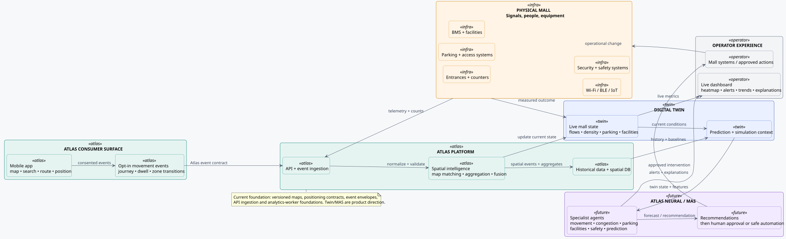
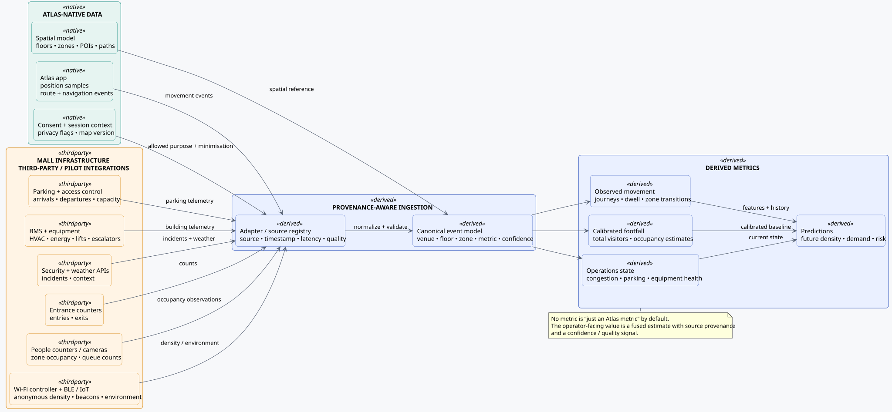
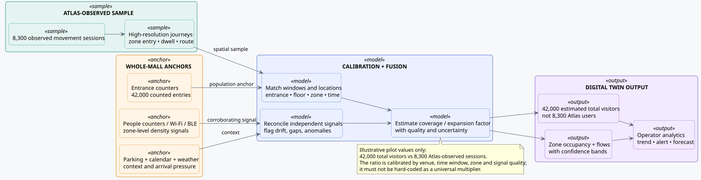
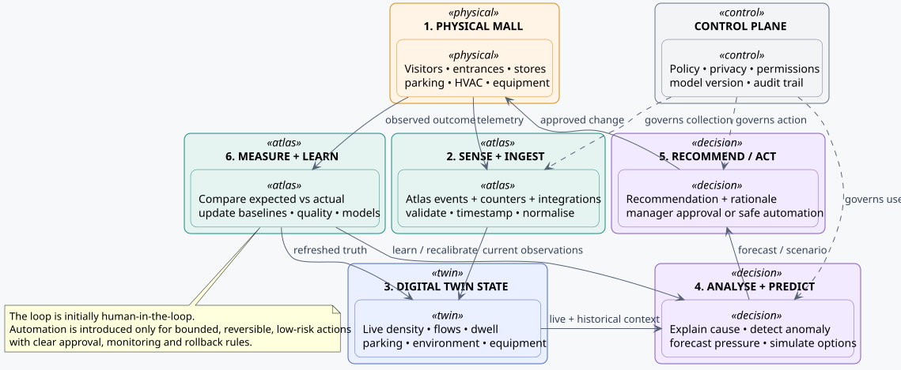
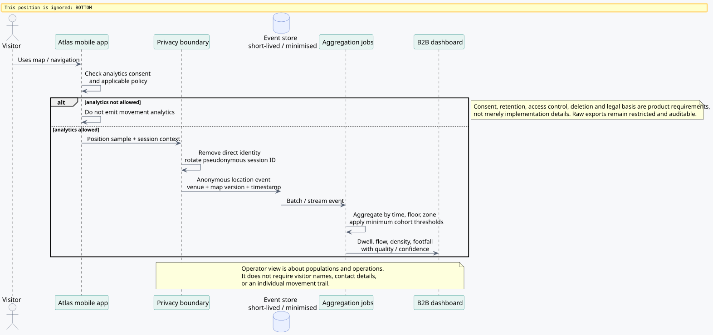
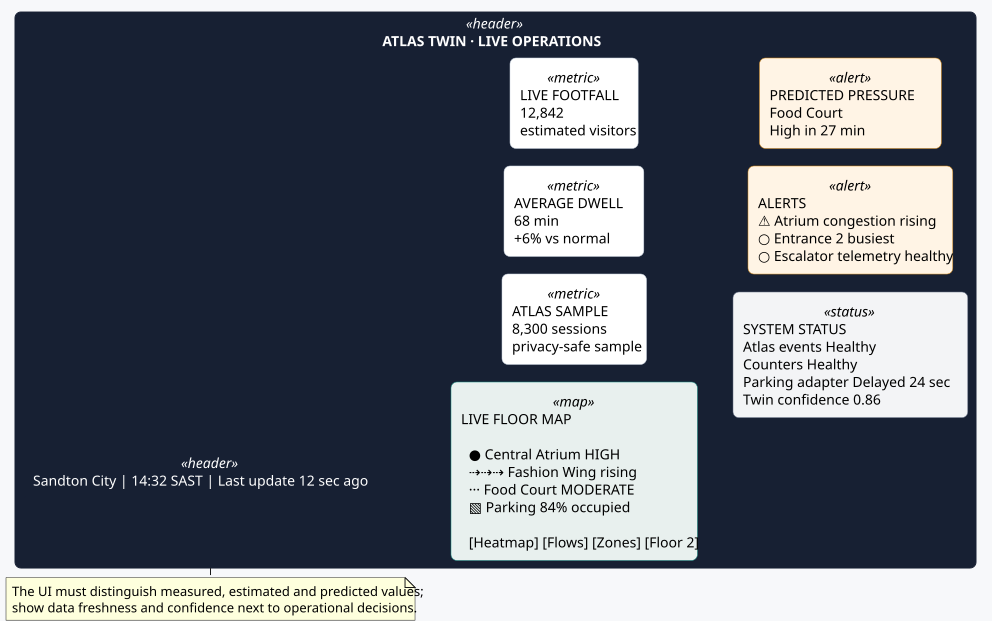
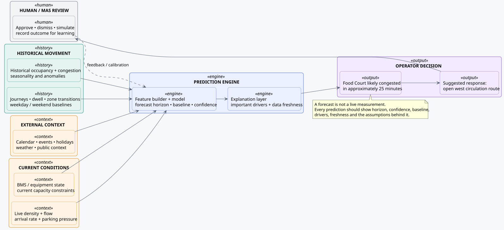
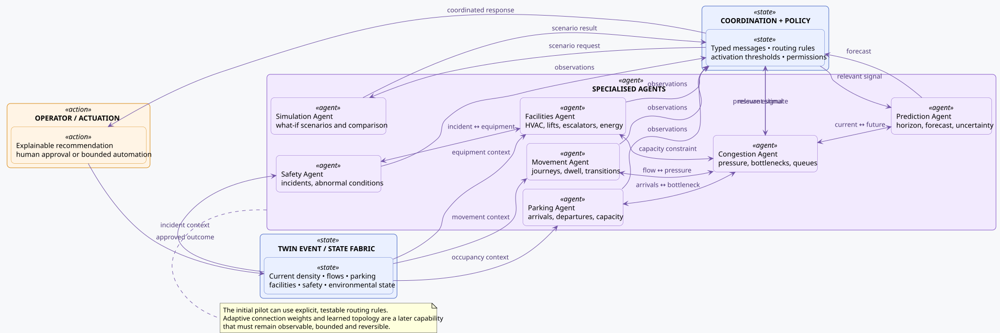
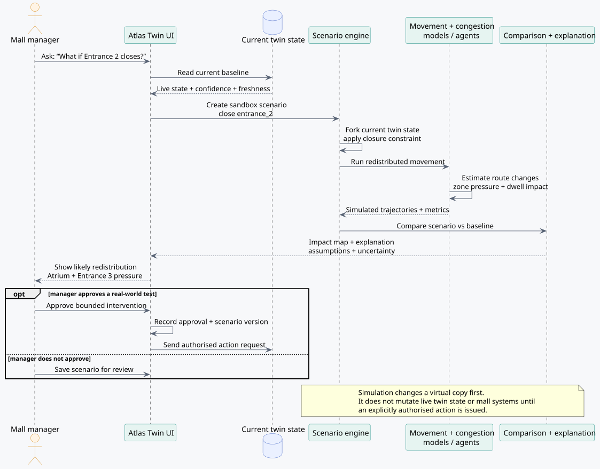
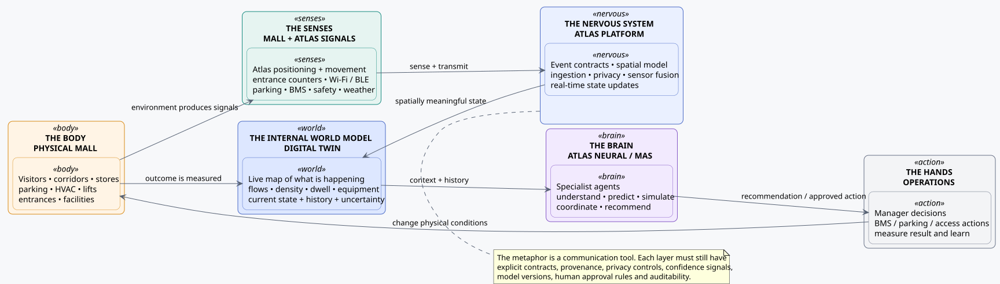

# Atlas B2B Digital Twin — Concept Architecture

This brief is the first executive-and-technical explanation of Atlas Digital Twin. It focuses on the ten views that explain the concept end to end:

1. the master architecture;
2. where every signal comes from;
3. how total mall footfall is estimated when Atlas sees only a sample;
4. the real-world feedback loop;
5. privacy and anonymisation;
6. the live operator view;
7. predictive intelligence;
8. the neural multi-agent system;
9. scenario simulation; and
10. the “digital nervous system” vision.

The editable sources are in [`diagrams/`](./diagrams/). Rendered SVGs are in [`rendered/`](./rendered/).

## How to read this document

Atlas has two complementary surfaces:

- **Consumer Atlas**: indoor maps, search, routing, positioning, and opt-in movement events.
- **Atlas B2B**: aggregated spatial intelligence for mall operators, including footfall, flows, dwell, congestion, prediction, simulation, and operational recommendations.

The diagrams use three status labels:

- **Current foundation** — represented by capabilities already present in the repository, such as versioned map packages, positioning types, event envelopes, API ingestion, and analytics-worker foundations.
- **Pilot integration** — an expected connection to a mall system or data provider; the exact protocol and commercial permissions are venue-specific.
- **Product direction** — the proposed Digital Twin and Neural MAS capability built above the foundation.

The architecture assumes aggregated, privacy-preserving analytics. The mall operator should receive operational insight, not a visitor identity or a raw individual movement trail.

## Executive summary

Atlas first creates the mall’s spatial foundation. It then combines Atlas-observed movement with counters, Wi-Fi/BLE/IoT, parking, building-management, and other infrastructure signals. The result is a live operational model of the mall: what is happening, where it is happening, why it may be happening, and what is likely to happen next.

The Digital Twin does not require every visitor to use Atlas. Atlas-observed journeys are a high-resolution sample; independent infrastructure calibrates that sample to the whole mall. This lets an operator distinguish “8,300 Atlas-observed sessions” from “42,000 estimated total visitors” without pretending that the sample is the population.

## Implementation alignment

The current Atlas repository already provides the spatial and event foundation for this direction:

| Atlas foundation | Repository surface | Role in the B2B architecture |
| --- | --- | --- |
| Versioned venue/map model | `packages/spatial-model`, `tooling/map-importer`, platform map-package services | Defines floors, POIs, navigation nodes, edges, and map versions. |
| Positioning contracts | `packages/positioning-core` | Defines position estimates, confidence, BLE/PDR/visual contributions, and calibration boundaries. |
| Movement/event contracts | `packages/analytics-events`, platform event ingestion | Defines privacy-aware event envelopes and movement events such as zone entry, exit, POI passage, and dwell. |
| API and analytics foundation | `services/platform-api`, `services/analytics-worker` | Provides the service boundary for ingestion, storage, validation, and aggregation. |
| Digital Twin and Neural MAS | Proposed product direction | Adds live state, sensor fusion, forecasting, simulation, agent coordination, and recommendations. |

The proposed layers should be implemented incrementally: map → positioning → movement intelligence → live twin → predictive twin → autonomous or human-approved MAS.

---

## 1. High-level architecture

**Executive meaning:** Atlas is the layer that turns many disconnected mall signals into one operational view of the physical environment.

**Technical meaning:** Atlas-native events and third-party telemetry enter a common ingestion and spatial-intelligence plane. The Digital Twin stores current state and history; analytics and MAS services derive predictions, recommendations, and controlled actions.



Source: [`01-high-level-architecture.puml`](./diagrams/01-high-level-architecture.puml)

## 3. Data source architecture

**Executive meaning:** each metric has a source and a confidence level. Atlas does not claim that the mobile app alone knows total footfall, parking occupancy, temperature, or equipment state.

**Technical meaning:** the source registry should retain provenance, timestamp, granularity, consent/legal basis, latency, and quality score for every signal before fusion.



Source: [`03-data-source-architecture.puml`](./diagrams/03-data-source-architecture.puml)

## 5. Whole-mall footfall estimation

**Executive meaning:** Atlas-observed movement is a sample. Counters and infrastructure signals help estimate the full mall population without inflating the sample into a false total.

**Technical meaning:** the estimator can calibrate Atlas-observed sessions against entrance counts and corroborating density signals, segmented by entrance, floor, zone, time window, and data quality. The exact estimator is a pilot/model decision, not a universal constant.



Source: [`05-whole-mall-footfall-estimation.puml`](./diagrams/05-whole-mall-footfall-estimation.puml)

## 7. Digital Twin data flow and feedback loop

**Executive meaning:** the twin is useful because it connects observation to action and then measures whether the action worked.

**Technical meaning:** every recommendation should preserve a causal trail: input signals, twin state, model version, recommendation, approval, actuator result, and post-action measurement.



Source: [`07-digital-twin-feedback-loop.puml`](./diagrams/07-digital-twin-feedback-loop.puml)

## 10. Visitor privacy and anonymisation

**Executive meaning:** management sees patterns and operational counts, not visitor names or individual trails.

**Technical meaning:** the client emits only when analytics consent and applicable policy allow it. Identifiers rotate, raw events are minimised, aggregation happens before operator-facing analytics, and retention/access controls remain explicit.



Source: [`10-visitor-privacy.puml`](./diagrams/10-visitor-privacy.puml)

## 11. Live Digital Twin operator view

**Executive meaning:** a mall manager should open one screen and immediately understand live footfall, zone pressure, dwell, alerts, parking, and system health.

**Technical meaning:** the dashboard consumes derived twin state and confidence metadata. It should never imply that every visible number came from Atlas users or that a prediction is a measurement.



Source: [`11-live-digital-twin-ui.puml`](./diagrams/11-live-digital-twin-ui.puml)

## 18. Predictive intelligence

**Executive meaning:** the product moves from “the food court is busy” to “the food court is likely to exceed normal capacity in 25 minutes, so open the west circulation route.”

**Technical meaning:** predictions combine current twin state, historical movement, arrival rates, calendar/events, weather, and operational context. Outputs need a horizon, confidence, baseline, and explanation.



Source: [`18-predictive-intelligence.puml`](./diagrams/18-predictive-intelligence.puml)

## 2. Neural topology / multi-agent system

**Executive meaning:** Atlas can use specialised operational experts—movement, congestion, parking, facilities, safety, and prediction—instead of one opaque “mall AI.”

**Technical meaning:** agents publish typed observations and recommendations through a shared event/state fabric. Connections are sparse and policy-governed; topology learning is a later research capability, not a prerequisite for the first pilot.



Source: [`02-neural-topology-mas.puml`](./diagrams/02-neural-topology-mas.puml)

## 22. Scenario simulation

**Executive meaning:** management can ask “what happens if Entrance 2 closes?” before changing the real mall. Atlas estimates redistributed flows, pressure points, and likely operational impact.

**Technical meaning:** the simulation forks the current twin state, applies a scenario constraint, runs movement/occupancy models, and returns a comparison against the baseline. It should be presented as a forecast with assumptions, not as certainty.



Source: [`22-scenario-simulation.puml`](./diagrams/22-scenario-simulation.puml)

## 30. Atlas as the mall’s digital nervous system

**Executive meaning:** the physical mall is the body, infrastructure is the senses, Atlas is the nervous system, the Digital Twin is the internal world model, and the MAS is the decision-making brain.

**Technical meaning:** this is the north-star metaphor for the stack. It is useful for communicating the product, but each metaphor maps to concrete services, data contracts, privacy controls, models, and human approval gates.



Source: [`30-atlas-nervous-system.puml`](./diagrams/30-atlas-nervous-system.puml)

## The single story these ten diagrams tell

```text
The mall produces signals.
Atlas preserves spatial meaning and privacy.
The Digital Twin fuses signals into a live state.
Analytics explains what is happening.
Prediction estimates what happens next.
The MAS coordinates specialised reasoning.
Simulation tests decisions before deployment.
The operator approves an intervention.
The twin measures the result and learns.
```

That is the B2B proposition: **Atlas does not only map the mall; it gives the mall a continuously updating operational model.**

## Next diagrams in the backlog

The remaining requested views should follow after this core narrative: movement tracking, sensor fusion, spatial zones, indoor positioning, heatmap generation, journey analytics, real-time event pipeline, spatial data model, twin state model, agent decision loop, neural activation, agent rewiring, integration, deployment, edge/cloud split, product ecosystem, maturity roadmap, and manager use-case flow.

