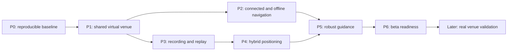

# Atlas indoor navigation roadmap: development without a real venue map

Planning baseline: 12 November 2026. Status: planned; implementation gates remain open.

## Outcome and scope

Build a complete navigation beta against synthetic venues, with connected map management, search, routing, offline operation, interchangeable positioning providers, recorded sensor sessions, deterministic replay, uncertainty handling and navigation recovery. A real venue floor plan is not a dependency for these engineering stages.

The endpoint is a beta whose software behaviour is verified in a virtual venue, with separately recorded physical-device evidence wherever devices are available. Reliable positioning at a named real venue remains a later field-validation milestone.

This roadmap narrows the immediate work in `techspec.md` sections 17–21. Its P0–P6 labels are execution stages for this scope, not replacements for the specification's Phase 0–4 labels. `progress.md` remains the implementation status tracker. No checkbox below is evidence that a feature is implemented.

## Starting position

| Area | Current evidence | Work remaining |
| --- | --- | --- |
| Mobile experience | Native SVG map, search/directory/saved places, previews, simulated guidance and arrival. On 12 November, mobile types and 284 schematic route cases plus viewport/camera/place-memory checks passed. | App still imports local fixtures and uses timer-driven movement. No live navigation provider is connected. |
| Synthetic spatial data | Deterministic two-floor generator, map validator and canonical JSON/checksum tooling exist. All 32 map-package contract checks passed on 12 November. | Current generator has a small graph and two POIs. Add realistic failure scenarios and renderable fixture geometry. |
| Backend | Map import/publication, search and multi-floor routing exist. A prior local PostGIS end-to-end run is documented. | Re-run backend integration checks; connect mobile and a usable operator interface. |
| Shared contracts | `MapPackageV1`, a backend package response and mobile-specific map types exist. | They have different shapes. Backend delivery lacks some renderer geometry; align or explicitly adapt the versioned wire contract before integration. |
| Routing | Kotlin backend router, shared TypeScript router and mobile demo router exist. | Specify consistent cost, start attachment, closure, restriction, transition and step-free semantics. Prove parity for online and offline results. |
| Positioning | Estimate types, BLE strategies, fingerprint matching and a visual-provider interface exist. | Step detector returns an empty array. Heading, pedestrian dead reckoning, fusion, floor inference, map matching and confidence are unfinished. |
| Recording/replay | Fixture types and documentation exist. | Calibration loader throws an unimplemented error; no runnable positioning replay suite exists. |
| Native QA | The build log records Android emulator interaction checks on 6 November. | Physical iOS/Android sensor tests and current native dependency compatibility remain separate evidence requirements. |
| Build reliability | Filtered mobile and contract commands ran in this session. | Workspace-wide typecheck encountered a pnpm nested-install/no-TTY failure. CI is absent; placeholder test scripts must not count as coverage. |

## Planning cadence and dependencies

Use short iterations of roughly one to two weeks, sized to actual available development time. The first iteration contains P0 and the first P1 contract slice. Re-estimate the next iteration from demonstrated progress; do not attach delivery dates before build and contract risks are resolved.

Each iteration ends with a runnable demonstration, relevant automated checks, an evidence note and an updated backlog. Finish a small vertical slice before expanding its breadth. Physical-device availability is tracked independently of venue-map availability.

P2 and P3 can advance independently once the coordinate and provider contracts are stable. With one implementer, alternate small slices rather than opening every stage at once. OpenHPS evaluation is timeboxed within P3/P4 and cannot hold up P2.

| Stage | Priority | Main result | Specification alignment |
| --- | --- | --- | --- |
| P0 | Now | Trustworthy build/test baseline and clear evidence | Phase 0 |
| P1 | Next | One versioned virtual venue consumed consistently | Phase 1 |
| P2 | Next | Search, routes and operator publication connected; offline fallback | Phase 1 |
| P3 | Next | Sensor capture, deterministic replay and provider comparison | Phase 2 |
| P4 | Then | Position estimation, map matching and uncertainty | Phase 2; simulated portions of Phase 3 |
| P5 | Then | Guidance, correction, rerouting and floor handling | Map-free portions of Phase 3 |
| P6 | Final map-free gate | Repeatable beta build, operator workflow and evidence report | Engineering subset of Phase 4; not a public venue pilot |

## P0 — Establish a reproducible baseline

Deliverables:

- [ ] Resolve the pnpm workspace invocation problem without discarding existing working changes; document the supported Node/package-manager setup.
- [ ] Run and record meaningful TypeScript, mobile, contract and backend checks. Record database-dependent skips explicitly.
- [ ] Add CI for implemented checks and secret scanning. Inventory placeholder/no-op test scripts so a green aggregate does not imply nonexistent coverage.
- [ ] Preserve the working schematic experience as a selectable demo and label simulation, replay and sensor modes explicitly.
- [ ] Create an evidence log identifying commit/working-tree state, commands, fixtures, platform and device/emulator for each result.

Gate: a clean installation can reproduce the baseline commands; deliberate type or contract breakage fails CI. A new contributor can start the virtual venue using documented steps. Device-only checks can remain pending with a named dependency.

Primary locations: root scripts/configuration, `.github/workflows/`, `apps/mobile/BUILD_CHECKS.md`, service build/test scripts.

## P1 — Make the virtual venue a shared product asset

Deliverables:

- [ ] Define one consumer map-package contract or a documented versioned adapter between the importer, backend and renderer. Include geometry, stable identities, units, entrances, transitions, accessibility and closure state needed downstream. Respect existing schema compatibility rules.
- [ ] Specify local metres, origin, axis directions, floor IDs, elevation, heading units/reference, timestamps and the transform into SVG display coordinates. Synthetic work requires no geographic survey or real GPS anchor.
- [ ] Extend the existing generator to a clearly fictional two-floor venue with at least 20 destinations, multiple starts, a lift, a stair/escalator alternative, a loop, a dead end and disconnected negative fixtures.
- [ ] Generate scenario variants for a closed corridor, unavailable lift, closed destination, one-way edge, inaccessible route and version update. Keep invalid graph packages separate from valid fixtures with temporarily unavailable routes.
- [ ] Render the generated venue in mobile through an adapter; retain the existing Sandton schematic as separate demo content.

Gate: identical seed/configuration produces identical package content/checksum. Every synthetic destination has a valid entrance and selection identity. Renderer and router agree on coordinates and floors. Invalid data is rejected with structured errors.

Primary locations: `packages/spatial-model`, `tooling/fixture-generator`, `tooling/map-importer`, `tests/contract`, `apps/mobile/src/map`, backend package delivery.

## P2 — Connect the full navigation journey and offline behaviour

Deliverables:

- [ ] Extend `packages/api-client` with typed venue/package/search/route operations and structured errors; validate the wire contract against exported OpenAPI and runtime fixtures.
- [ ] Load a published synthetic venue in mobile, search its directory, select a starting entrance and request a backend route. Preserve useful loading, empty, unavailable and retry states.
- [ ] Deliver a minimal authenticated operator flow: import a package, inspect validation, publish/rollback and change a closure. Never place privileged API keys in the mobile bundle.
- [ ] Define one route policy for online/offline use. Strengthen the shared local router and prove equivalence with backend results on fixture costs, legal transitions, closures and route constraints. Allow different equally optimal paths only when both satisfy the same contract.
- [ ] Cache a complete validated map package, searchable directory and graph atomically; route offline after a restart. Keep active navigation pinned to one version and handle replacement explicitly.
- [ ] Show last-sync information. Offline closures reflect the last received snapshot; urgent remote changes cannot be guaranteed until connectivity returns. Reject unusable packages and explain unavailable routes.

Gate: operator publishes -> mobile loads -> user searches -> selects start -> previews a two-floor route. The same workflow works with a cached package offline. Uncached, corrupt, incompatible, stale and disconnected states have tested behaviour. Online and offline routes respect the same constraints.

Primary locations: `packages/api-client`, `packages/routing-core`, `services/platform-api`, `apps/mobile`, `apps/venue-dashboard`, integration/contract tests.

## P3 — Build recording, replay and a controlled framework experiment

Deliverables:

- [ ] Define platform-independent observation and provider interfaces for motion, heading, BLE, pressure, manual fixes and replay. Route all providers through the Atlas estimate contract.
- [ ] Detect permissions and hardware capabilities; support missing sensors, denied permission and foreground/background transitions without fabricated observations.
- [ ] Implement an opt-in diagnostic recorder with monotonic timing, sensor units/reference frames, device/carrying-state metadata, algorithm/configuration version and checkpoint labels. Raw exports stay local/ignored; commit only generated or reviewed, de-identified fixtures.
- [ ] Implement a versioned replay format, validator, runner and report. Inject clock and random seed so identical logs/configuration produce repeatable output. Separate measured, simulated and unlabelled ground truth.
- [ ] Add at least 12 deterministic scenario logs covering straight walking, corners, stopping, phone rotation, pocket carry, missing/noisy/stale radio data, delayed/out-of-order samples, wrong-floor observations, correction and an unreachable destination.
- [ ] Timebox an OpenHPS core/IMU/React Native experiment to three development sessions. Compare one replay and one native sensor capture through the same Atlas adapter against a simple baseline. Record compatibility, licensing/dependencies, output quality and runtime cost; adopt only demonstrated pieces.

Gate: the replay command works without a phone or network; repeated runs reproduce estimates and summary metrics. Malformed logs fail clearly. With a phone available, a short capture exports and replays successfully. If no phone is available, software/replay gates can close while the native capture gate stays open.

Primary locations: `packages/positioning-core`, `tooling/calibration-console`, `tooling/fixture-generator`, `tests/positioning-replays`, mobile diagnostic/sensor adapters.

## P4 — Implement and evaluate hybrid positioning

Deliverables:

- [ ] Implement step detection and configurable step length, comparing generated counts and available manually counted phone walks. Add a heading baseline, coordinate-frame conversion and disturbance indicators.
- [ ] Integrate pedestrian dead reckoning from a known start. Handle inactivity, stale samples and changes in phone orientation/carrying state; expose uncertainty when walking direction cannot be inferred reliably.
- [ ] Fuse manual/checkpoint fixes and available BLE/fingerprint observations with freshness and outlier checks. Simulate known beacon layouts; add physical BLE sampling only when hardware is available.
- [ ] Implement corridor map matching using distance, heading, continuity and legal transitions. Preserve the raw estimate and allow an off-graph state; avoid forcing every observation onto the selected route or increasing confidence solely because it was snapped.
- [ ] Implement confidence decay/recovery, bounded correction behaviour and floor candidates. Default to user confirmation when floor evidence is insufficient.
- [ ] Compare baseline versus candidate on held-out scenario seeds and available recorded sessions. Report median/95th-percentile error only where independent coordinate truth exists, plus step-count error, floor mistakes, lost-state duration and correction recovery.

Gate: the full position pipeline runs deterministically on replay. Expected high/low/lost transitions and rejected outliers are asserted. Candidate changes publish accuracy/regression reports; simulated metrics stay labelled as simulated. Physical sensor results are reported separately and cannot establish store-level accuracy without surveyed reference points.

Primary locations: `packages/positioning-core`, provider adapters, replay reports/tests and mobile estimate presentation.

## P5 — Make guidance cope with uncertainty and mistakes

Deliverables:

- [ ] Replace timer-driven progression in navigation mode with provider estimates; keep the accelerated demo as an explicitly selected simulator.
- [ ] Add distance-to-turn, meaningful turn instructions, remaining distance/time and arrival rules tied to route progress, floor and position uncertainty. Do not declare arrival solely because the replay/simulator reached its last index.
- [ ] Add stable off-route detection and rerouting with hysteresis, including backtracking, parallel corridors and network loss. Avoid reroute loops and impossible jumps through walls.
- [ ] Add manual place/floor correction and a QR checkpoint workflow. Printed synthetic checkpoint IDs prove scanning and correction behaviour; they are not surveyed positions in a real building.
- [ ] Implement floor-transition states and step-free failure behaviour; confirm a floor when evidence is ambiguous. Test unavailable lifts and routes with no accessible alternative using synthetic metadata.
- [ ] Add optional spoken/haptic cues, persisted preferences and accessible route steps; test permission denial, large text, reduced motion, interruption/resume and screen-reader operation on available devices.

Gate: each named scenario completes or ends in the expected useful failure state. Wrong turns, loss of signal, incorrect floor, correction, backgrounding and lost connectivity are exercised. Demo, replay and live sensor modes do not silently substitute for one another.

Primary locations: mobile navigation state and components, routing/provider contracts, replay and end-to-end navigation tests.

## P6 — Complete a beta ready for later venue validation

The [beta readiness report](indoor-navigation-beta-readiness.md) tracks evidence and the device walkthrough for this gate.

Deliverables:

- [ ] Finish operator validation/publication/rollback/closure workflows and minimal diagnostic reports. Keep advertising, billing and whole-venue intelligence outside this milestone.
- [ ] Produce repeatable Android/iOS development or distribution builds as credentials/devices permit. Mark each platform ready only after its own installation and runtime checks.
- [ ] Add app/API diagnostic IDs, actionable errors and bounded local diagnostics. Apply opt-in recording, deletion and retention controls before collecting identifiable session data.
- [ ] Exercise a synthetic staging environment and its configuration/authentication, map-update recovery and backup/recovery procedures. Production release remains a separate action.
- [ ] Measure route latency and memory/render performance on declared fixtures, plus battery/sensor behaviour on available physical devices. Set regression budgets from an agreed baseline and record sample sizes.
- [ ] Create a single readiness report linking automated checks, end-to-end results, recordings/replays and device evidence, with remaining venue/device dependencies visible.

Gate: the acceptance matrix below is complete for available environments, every pending physical-device requirement is explicit, and no known critical navigation/data-loss issue remains. A laptop-only completion is labelled a software/replay beta; physical-device readiness requires the device rows to pass.

## Map-free acceptance matrix

These are proposed acceptance criteria, not measured product outcomes.

| Area | Acceptance evidence | Real venue map needed? | Other dependency |
| --- | --- | --- | --- |
| Spatial contract | Generated multi-floor packages validate; malformed and incompatible data is rejected | No | None beyond development setup |
| Search and routing | Every generated destination is covered; closed/one-way/restricted/step-free variants return a legal route or explicit no-route result | No | Local API/database for backend checks |
| Operator workflow | Import, validation, publication, rollback and closure change reach the consumer | No | Local or synthetic staging services |
| Offline use | Cached package supports restart, directory and rerouting; interrupted updates preserve the last valid version | No | Emulator/device storage checks |
| Replay | At least 12 named scenarios; deterministic results and baseline/candidate comparison | No | None beyond development setup |
| Sensor capture | Permission states, capability detection, timestamp integrity, export and replay | No | Physical phone for actual sensors |
| Relative walking | Manually counted/measured straight and turning walks; drift and carrying-state results recorded separately | No floor plan | Phone and independently measured distance/turns |
| Position corrections | Manual and synthetic QR fixes recover the expected simulated/replayed state | No | Camera device for physical QR scan |
| Floor handling | Synthetic transitions and ambiguous/lost states behave correctly | No | Physical stairs/lift testing is optional additional evidence |
| UI/accessibility | Native navigation, interruption, screen-reader and large-text checks per platform | No | Matching device/platform accessibility tools |
| Performance | Declared fixture sizes, device specs and repeatable latency/render/memory/battery reports | No | Physical devices for battery and frame pacing |
| Real corridor/store accuracy | Independent surveyed checkpoints and actual entrance/floor agreement | Yes | Permitted site access and reference measurements |

There is no arbitrary metre-accuracy promise in the map-free gate. Generated ground truth can validate an algorithm against a simulation; it cannot certify behaviour in a particular mall. Public datasets, if used, must be labelled by source, device and environment and kept separate from Atlas field results.

## First iteration: ordered implementation backlog

Start with the following sequence. If the iteration fills, move the remaining items forward; do not mark them complete by reducing their acceptance criteria.

| ID | Work item | Depends on | Done when |
| --- | --- | --- | --- |
| MF-001 | Fix reproducible workspace checks and inventory placeholder tests | None | Clean setup and meaningful checks are documented; pnpm invocation no longer prompts/removes modules unexpectedly |
| MF-002 | Add CI for the working mobile/contract/type checks and secret scanning | MF-001 | A deliberately broken type/contract is rejected; database skips are visible |
| MF-003 | Write the consumer package/coordinate/route contract and adapter decision | None | Backend, importer and mobile differences, including missing render geometry and constraint metadata, have an explicit resolution with example payloads |
| MF-004 | Extend the generator to the fictional multi-floor test venue | MF-003 | At least 20 destinations, alternate transitions and failure variants validate deterministically |
| MF-005 | Render the generated package in mobile | MF-004 | Selectable floors/places use package IDs and the defined coordinate transform |
| MF-006 | Add typed package/search/route client operations | MF-003 | Requests and success/error payloads pass runtime/contract checks |
| MF-007 | Demonstrate a backend-generated route in the native app | MF-005, MF-006 | Select a synthetic start and destination; display the matching floor segments and entrance endpoint |
| MF-008 | Specify the replay format and provider interface | MF-003 | Units, monotonic timing, versioning, truth provenance and deterministic-clock rules are explicit |

First demonstration target: import and publish the generated venue using the existing backend tooling, then load it and display a backend-calculated two-floor route in mobile. The operator UI, offline parity and positioning gates follow; they are not implied by this first demonstration.

Next queued slice: recorder/replay runner, one baseline sensor capture, then the timeboxed OpenHPS comparison. Starting with this order gives positioning a stable coordinate and routing contract.

## Architecture and scope decisions

- Atlas retains ownership of venue identity, map/route contracts, confidence presentation and consumer UI. External algorithms sit behind an internal provider adapter; `positioning-core` remains independent of React Native.
- OpenHPS is the first candidate to evaluate, not an approved migration. Use the smallest demonstrated subset. Expo native-library integration must be verified in a development build.
- Navigine stays an optional commercially licensed provider experiment. No account purchase, SDK integration or licence acceptance is part of this plan.
- Redpin informs labelled fingerprint collection and correction workflows. Its historical client/server code is not the default implementation path.
- Wi-Fi scan access is platform-specific; do not make general Wi-Fi scanning a dependency of the iOS experience. BLE and camera hardware are optional inputs with explicit unavailable states.
- Start with manual known-position/floor selection. QR fixes can follow. Camera SLAM/AR recognition, UWB/AoA deployment and automatic whole-building localisation are outside this milestone.
- Preserve the current visual design while integrating real data flow. Target UI work at navigation clarity, accessibility and failure states.
- Defer advertising/billing, multi-venue rollout, predictive digital twins and venue-wide footfall claims. Minimal navigation diagnostics and test reports are in scope.

## Later boundary: work unlocked by a real venue

When a permitted test area becomes available, replace synthetic data through the same package contract, establish its scale/orientation and independently measured checkpoints, confirm entrances/floors/accessibility, and survey any radio anchors. Run the existing test matrix on actual routes and tune confidence against those observations. A small measured office/corridor can serve as the first site; a full mall map is not required to begin that later stage.

Site-specific accuracy, beacon coverage, automatic floor reliability, accessible-route correctness, visitor success and whole-venue analytics remain unverified until their corresponding field studies. These later requirements do not block P0–P6 software work.

## Working references

- Project intent and original phase definitions: `techspec.md`, sections 6, 7, 14, 17–21.
- Current implementation tracker: `progress.md`; native evidence: `apps/mobile/BUILD_CHECKS.md`.
- Package contract: `docs/mapping/map-package-contract.md`; current schematic limits: `docs/sandton-demo-map.md`.
- Backend exercise: `tests/end-to-end/README.md`; replay requirements: `tests/positioning-replays/README.md`.
- [OpenHPS introduction](https://openhps.org/docs/introduction/) and [React Native adapters](https://github.com/OpenHPS/openhps-react-native).
- [Navigine package definition](https://github.com/Navigine/Indoor-Navigation-iOS-Mobile-SDK-2.0/blob/main/Package.swift) and [licence notice](https://github.com/Navigine/Indoor-Navigation-iOS-Mobile-SDK-2.0/blob/main/LICENSE.md).
- [Redpin original paper](https://vs.inf.ethz.ch/publ/papers/bolligph-redpin2008.pdf).
- [Apple Wi-Fi API constraints](https://developer.apple.com/documentation/technotes/tn3111-ios-wifi-api-overview) and [Expo native code/development builds](https://docs.expo.dev/workflow/customizing/).
