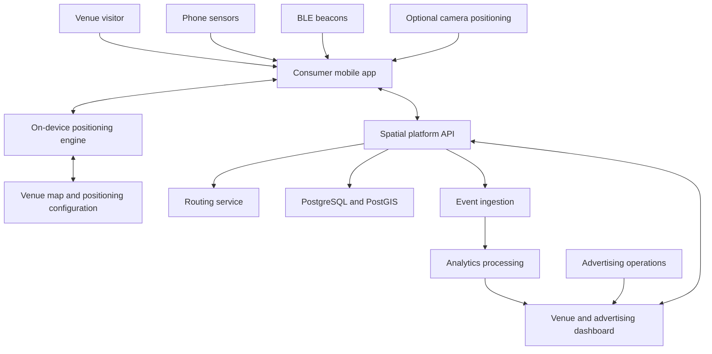
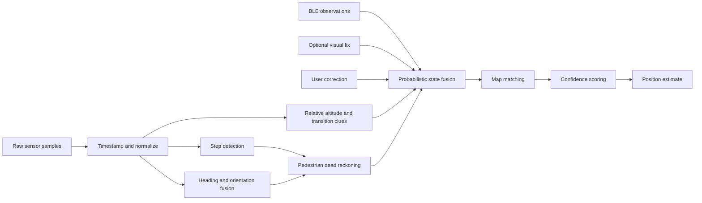

# Indoor Spatial Navigation Platform

## Technical Specification v0.1

**Status:** Development baseline  
**Date:** 4 August 2026  
**Classification:** Strictly confidential — internal founding team only  
**Product owner:** Anotida Dzinotyiwei  
**Preferred pilot:** Sandton City or a smaller cooperative validation venue  

---

## 1. Purpose

This specification defines the first buildable architecture for a consumer indoor-navigation platform. The platform should allow a person inside a complex building to:

- identify the current venue;
- search for stores, facilities, products, categories, and destinations;
- view an accurate multi-floor indoor map;
- calculate the shortest valid route;
- follow an estimated moving position marker;
- understand when positioning confidence is low;
- correct their location manually or through optional camera assistance; and
- receive relevant venue information and advertising.

The system must also provide venue operators with map-management, advertising, and aggregated movement-analytics capabilities.

This is a development baseline, not a claim that indoor positioning has already been solved. Positioning accuracy must be demonstrated through controlled field testing.

---

## 2. System boundaries

Development is organised around four main product systems:

1. **Consumer mobile application**
2. **Indoor positioning engine**
3. **Spatial-data and analytics platform**
4. **Venue and advertising dashboard**

The first implementation should use one monorepo. These systems can become separate repositories later when they have independent teams, release cycles, licensing requirements, or security boundaries.



### 2.1 Runtime boundary

The positioning engine is not purely a backend service. Its latency-sensitive loop must run on the phone while navigation is active. The backend supplies maps, beacon configuration, routing information, calibration models, and analytics ingestion.

The backend must not be required for every position update. A temporary loss of connectivity should not immediately stop an active route if the required map and route are already cached.

---

## 3. Initial technology choices

| Area | Initial choice | Reason |
|---|---|---|
| Mobile | React Native, Expo development builds, TypeScript | Shared iOS/Android codebase and access to sensors, camera, QR/barcode capabilities, and native extensions |
| Mobile map rendering | React Native Skia or equivalent canvas renderer | Custom multi-floor vector maps, routes, labels, markers, zoom, and rotation |
| Dashboard | Next.js and TypeScript | Rapid internal tool development and shared types with mobile |
| Backend API | Spring Boot with Kotlin preferred; Java acceptable | Strong typed services, mature security/data ecosystem, and team direction |
| Spatial database | PostgreSQL with PostGIS | Venue geometry, spatial queries, map versions, and analytics aggregation |
| Cache and queues | Begin without dedicated infrastructure; add Redis or a managed queue when measured load requires it | Avoid premature operational complexity |
| Object storage | S3-compatible storage | Floor-plan source files, map packages, exports, and calibration logs |
| Hosting | Railway or equivalent managed container platform | Simple pilot deployment; final provider remains replaceable |
| Observability | Structured logs, error tracking, metrics, trace/session IDs | Debugging field failures across phones and venue zones |
| API description | OpenAPI 3.1 | Contract generation, testing, and client compatibility |

### 3.1 Architecture decision rule

Every dependency must be replaceable behind an internal interface where practical. A third-party indoor-positioning SDK may accelerate validation, but the platform must retain ownership of:

- the canonical venue model;
- route calculation and constraints;
- confidence representation;
- analytics event definitions;
- consumer experience; and
- commercial data products.

---

## 4. Monorepo structure

```text
indoor-navigation-platform/
├── apps/
│   ├── mobile/                    # React Native consumer application
│   └── venue-dashboard/           # Next.js operator and advertising UI
├── services/
│   ├── platform-api/              # Spring Boot public/internal API
│   └── analytics-worker/          # Event validation and aggregation jobs
├── packages/
│   ├── positioning-core/          # Pure positioning algorithms and models
│   ├── spatial-model/             # Shared venue/map schemas
│   ├── routing-core/              # Graph construction and route rules
│   ├── map-rendering/             # Shared map styling and render helpers
│   ├── analytics-events/          # Event names, schemas, validation
│   ├── api-client/                # Generated TypeScript API client
│   └── shared-types/              # Cross-application types and constants
├── tooling/
│   ├── map-importer/              # GIS/map package validation and import
│   ├── calibration-console/       # Field-log inspection and tuning tools
│   └── fixture-generator/         # Synthetic venues and movement sessions
├── infrastructure/
│   ├── local/                     # Local database and service configuration
│   ├── environments/              # Development, staging, pilot
│   └── migrations/                # Database migration ownership
├── docs/
│   ├── architecture-decisions/    # ADRs
│   ├── api/                       # API and event documentation
│   ├── mapping/                   # Map production standards
│   └── field-testing/             # Test plans and calibration reports
└── tests/
    ├── end-to-end/
    ├── contract/
    ├── positioning-replays/
    └── performance/
```

### 4.1 Repository rules

- The monorepo is the source of truth for code and technical documentation.
- No application imports another application directly.
- Shared packages must expose documented public APIs.
- The mobile application may depend on `positioning-core`, but `positioning-core` must not depend on React Native UI code.
- Spatial schemas are versioned and backward-compatible within a released pilot map package.
- Every database change uses a migration.
- Secrets, production datasets, architectural drawings, and raw movement exports must not be committed.

---

## 5. Consumer mobile application

### 5.1 Primary navigation flow

1. Launch the application.
2. Request foreground location and required motion permissions with a clear explanation.
3. Detect candidate venue using geofencing and backend venue bounds.
4. If one venue is highly likely, open it automatically. Otherwise present nearby venues.
5. Load the latest compatible venue map package and positioning configuration.
6. Estimate initial indoor position.
7. If confidence is insufficient, ask the user to tap their approximate position, select a nearby landmark, or optionally use the camera.
8. Allow search and destination selection.
9. Request or calculate a route from the current map-matched position.
10. Start the active-navigation session and display route, moving marker, floor, instruction, and confidence.
11. Reroute when the user departs from the expected path with sufficient confidence.
12. End the session when the destination is reached or the user stops navigation.

### 5.2 Required pilot screens

- Permission and privacy explanation
- Venue detection/loading state
- Venue map and floor selector
- Search and results
- Destination details
- Route preview
- Active navigation
- Position correction
- Optional camera positioning
- Error/offline state
- Basic promotion placement
- Privacy and personalised-advertising controls

### 5.3 Active-navigation interface

The interface must display:

- current floor;
- estimated position marker;
- orientation or movement direction when reliable;
- route polyline;
- next transition or turn;
- destination and estimated remaining distance;
- position-confidence state;
- a visible recalibration action;
- stop-navigation control; and
- floor-transition instruction when relevant.

Confidence must be understandable, not presented only as a decimal. Initial states:

- **High:** position is well constrained by recent beacon or visual evidence and map matching.
- **Medium:** position is plausible but drift is increasing.
- **Low:** position may be inaccurate; navigation continues with a correction prompt.
- **Lost:** no safe route-relative estimate is available; ask the user to correct position.

### 5.4 Offline and caching behaviour

The product is internet-dependent like Waze, but active navigation should degrade gracefully:

- Cache the active venue package, selected route, POIs, and beacon configuration.
- Buffer analytics events locally using an encrypted queue.
- Continue local positioning and map matching during a temporary network loss.
- Disable new remote searches, advertisement refreshes, and server routing if data is unavailable.
- Upload buffered events when connectivity returns, subject to retention and consent rules.

---

## 6. Indoor positioning engine

### 6.1 Responsibilities

The positioning engine produces a time-ordered estimate:

```ts
type PositionEstimate = {
  venueId: string;
  floorId: string | null;
  x: number;
  y: number;
  headingDegrees: number | null;
  speedMps: number | null;
  horizontalAccuracyM: number;
  confidence: "high" | "medium" | "low" | "lost";
  confidenceScore: number; // 0..1, internal/diagnostic
  sourceContributions: Array<
    "manual" | "pdr" | "ble" | "visual" | "map_match" | "barometer"
  >;
  timestamp: string;
};
```

### 6.2 Inputs

- Known or user-confirmed starting position
- Accelerometer
- Gyroscope
- Magnetometer/device heading
- Device-motion/fused orientation data
- Barometer where available
- BLE scan observations
- Optional camera-derived landmark or pose result
- Venue walkable graph and geometry
- Floor-transition geometry
- Recent route and movement history
- Device capabilities and calibration profile

### 6.3 Processing pipeline



### 6.4 Step detection

Initial implementation:

1. Sample acceleration/device motion at a configurable 20–50 Hz.
2. Convert samples to a stable gravity-relative or magnitude signal.
3. Apply low-pass/high-pass filtering as required.
4. Detect candidate peaks above a configurable threshold.
5. Enforce minimum and maximum step intervals.
6. Score each candidate using amplitude, periodicity, and recent cadence.
7. Emit a step only when the confidence threshold is met.

The algorithm must be deterministic against recorded sensor logs. All tuning values must be configuration, not hard-coded throughout UI code.

### 6.5 Step-length estimation

Begin with a configurable default step length. Support later calibration using:

- observed cadence;
- acceleration variance;
- known-distance calibration walks;
- optional user height; and
- device/carrying-state models.

No demographic input should be required for the first pilot.

### 6.6 Heading estimation

- Prefer operating-system fused motion/orientation data as the initial baseline.
- Use gyroscope change for short-term rotation.
- Treat magnetometer heading as noisy evidence, especially near metal infrastructure.
- Detect implausible jumps and temporary magnetic disturbance.
- Reduce heading confidence when the phone appears loose in a bag or changes orientation independently of walking direction.
- Infer direction of travel from recent matched movement when device heading is unreliable.

### 6.7 BLE positioning

Beacon deployment is company-provided and maintained.

The engine must:

- scan supported BLE advertisement formats;
- map beacon identifiers to venue coordinates and floors;
- smooth RSSI observations over a short window;
- reject stale and physically implausible observations;
- use calibrated signal models per zone where possible;
- support nearest-beacon, weighted-centroid, fingerprint, and probabilistic approaches behind a common interface; and
- record beacon health without exposing identifiers unnecessarily to advertisers.

RSSI must not be converted directly into an exact distance and treated as truth. Indoor radio reflections require empirical calibration.

### 6.8 Floor detection

Floor evidence may come from:

- map-constrained use of stairs, lifts, and escalators;
- barometric change relative to a recent baseline;
- beacon observations associated with one floor;
- optional visual fixes; and
- user confirmation.

A floor change is confirmed only when multiple signals or one high-confidence signal agree. The engine must support phones without a barometer.

### 6.9 Map matching

Map matching constrains estimates to valid navigable geometry.

Candidate edges should be scored using:

- perpendicular distance from the raw estimate;
- direction compatibility;
- continuity from the previous matched edge;
- route compatibility, without forcing the user to remain on the route;
- transition legality between floors; and
- uncertainty radius.

The engine must not snap a user across a wall or between disconnected corridors merely because another edge is geometrically close.

### 6.10 Confidence model

Confidence should decay with:

- time and distance since a trusted fix;
- disagreement between sensors;
- unstable phone orientation;
- magnetic disturbance;
- sparse or inconsistent beacon observations;
- unmatched raw movement; and
- impossible movement speed or floor transitions.

Confidence should increase with:

- user-confirmed position;
- high-quality visual fix;
- stable calibrated beacon evidence;
- continuous map-compatible walking; and
- agreement between independent signals.

Thresholds must be tuned through replayable field sessions.

### 6.11 Positioning acceptance criteria

The principal pilot test is whether a user can complete a route without manual correction. Supporting measurements:

- median and 95th-percentile map-matched error;
- correct-floor rate;
- route-completion rate without correction;
- time spent in low/lost confidence;
- false reroute count;
- recovery time after phone returns from a handbag or pocket;
- battery consumed per 30 minutes of navigation; and
- differences by phone model and operating system.

The target experience is approximately 1–5 metres, but no accuracy claim is released until measured in the pilot environment.

---

## 7. Spatial model and routing

### 7.1 Coordinate systems

Each venue must define:

- a global geographic anchor and bounding polygon;
- a local metric coordinate system for indoor calculations;
- transforms between source-plan coordinates, local metres, and geographic coordinates; and
- one vertical reference per floor.

Rendering coordinates must not become the canonical data format.

### 7.2 Core entities

```text
Venue
 ├─ Building
 │   ├─ Floor
 │   │   ├─ Geometry layer
 │   │   ├─ Navigable nodes
 │   │   ├─ Navigable edges
 │   │   ├─ Spaces
 │   │   ├─ Entrances and doors
 │   │   └─ Points of interest
 │   └─ Vertical transitions
 ├─ Beacon configuration
 ├─ Map versions
 └─ Operating state and closures
```

### 7.3 Minimum data model

#### Venue

- `id`
- `slug`
- `name`
- `status`
- `timezone`
- `geographicBoundary`
- `defaultMapVersionId`
- `createdAt`, `updatedAt`

#### Floor

- `id`, `venueId`, `buildingId`
- `name`, `ordinal`, `publicLabel`
- `elevationM`
- `localBounds`
- `sourceScale`

#### Point of interest

- `id`, `venueId`, `floorId`
- `name`, `aliases`
- `type`, `categories`, `keywords`
- `spaceGeometry`
- one or more `entranceNodeIds`
- `openingStatus`
- `searchableMetadata`
- `accessibilityMetadata`

#### Navigation node

- `id`, `floorId`
- `x`, `y`
- `nodeType`
- `transitionGroupId` where applicable

#### Navigation edge

- `id`, `fromNodeId`, `toNodeId`
- `geometry`
- `distanceM`
- `estimatedTimeS`
- `directionality`
- `edgeType`
- `isAccessible`
- `isRestricted`
- `validFrom`, `validUntil`

#### Map version

- `id`, `venueId`, `version`
- `status`: draft, validated, published, retired
- `schemaVersion`
- `contentHash`
- `publishedAt`
- `minimumAppVersion`

### 7.4 Route calculation

Use A* initially with straight-line or graph-derived admissible heuristics.

Routing priority:

1. Apply hard safety, access, closure, and user constraints.
2. Create the set of valid edges.
3. Calculate the shortest or fastest valid route.
4. Apply any allowed commercial routing rule within a separately configured maximum detour.
5. Record whether sponsorship changed the selected route.

For the pilot, default routing optimises shortest valid distance. Accessibility routing is deferred but the data model must preserve accessibility attributes.

### 7.5 Commercial routing control

The current product decision permits silent sponsored route influence when the detour is negligible. The engine must isolate this policy from core routing.

Provisional internal constraints:

- maximum additional time: 30 seconds;
- maximum additional distance: 5%;
- use the stricter limit;
- never override safety, closure, access, or explicit user requirements;
- log original route, selected route, campaign, added distance, and added time; and
- allow immediate disabling per venue or globally.

These thresholds remain a product decision requiring validation before launch.

---

## 8. Spatial-data and analytics platform

### 8.1 Responsibilities

- Venue, floor, POI, graph, and map-version storage
- Search indexing and ranking
- Route calculation
- Map package generation and distribution
- Positioning configuration distribution
- Event ingestion and validation
- Aggregation of movement and advertising events
- Venue and campaign reporting
- User privacy choices and deletion workflows
- Operational audit logging

### 8.2 Event ingestion principles

- Accept events in batches.
- Assign server receipt time while preserving device event time.
- Validate event schema and compatible version.
- Make ingestion idempotent using `eventId`.
- Reject or quarantine impossible, malformed, or oversized events.
- Never trust venue, advertiser, or billing identifiers supplied only by the client.
- Separate operational telemetry from commercial analytics.

### 8.3 Common event envelope

```json
{
  "eventId": "uuid",
  "eventName": "navigation.position_sampled",
  "schemaVersion": 1,
  "occurredAt": "2026-08-04T08:30:00Z",
  "sessionId": "random-session-id",
  "installationId": "rotatable-random-id",
  "venueId": "venue-id",
  "mapVersionId": "map-version-id",
  "appVersion": "0.1.0",
  "platform": "ios",
  "privacy": {
    "analyticsAllowed": true,
    "personalisedAdsAllowed": false
  },
  "payload": {}
}
```

### 8.4 Initial event catalogue

#### Product events

- `venue.detected`
- `venue.selected`
- `search.submitted`
- `search.result_selected`
- `destination.viewed`
- `route.requested`
- `route.started`
- `route.rerouted`
- `route.completed`
- `route.abandoned`
- `position.corrected`
- `position.confidence_changed`
- `floor.transition_detected`

#### Movement events

- `navigation.position_sampled`
- `zone.entered`
- `zone.exited`
- `poi.passed`
- `poi.entered` only when the model is sufficiently reliable
- `dwell.completed`

#### Advertising events

- `ad.eligible`
- `ad.impression`
- `ad.clicked`
- `ad.destination_selected`
- `ad.route_influenced`

#### Quality events

- `sensor.capabilities_detected`
- `positioning.fix_received`
- `positioning.anomaly_detected`
- `map.issue_reported`
- `app.error`

### 8.5 Position sampling policy

Do not send raw sensor samples continuously to the general analytics endpoint. Raw accelerometer, gyroscope, magnetometer, BLE, and camera-derived debugging data belongs in explicit field-test sessions with restricted access.

For ordinary navigation analytics:

- sample map-matched position at a controlled interval or meaningful change;
- reduce precision where exact coordinates are not needed;
- aggregate into venue zones for commercial reporting;
- retain consent state with each event; and
- define retention periods before public launch.

### 8.6 Analytics outputs

Initial venue and advertiser outputs:

- searches and unsuccessful searches;
- routes requested and completed;
- destination demand;
- zone-level footfall estimates;
- corridor and floor movement;
- dwell estimates;
- peak periods;
- advertisement impressions and engagement;
- route-influenced campaign counts;
- positioning-confidence and correction rates.

Advertisers receive segments and aggregated reporting, not records that permit reconstruction of an individual journey.

---

## 9. Venue and advertising dashboard

### 9.1 Roles

- `platform_admin`: full company control
- `mapping_operator`: maps, POIs, graph, closures, validation
- `venue_admin`: venue content, tenants, events, operating status
- `ad_operator`: campaigns, creatives, targeting, budgets
- `analyst`: read-only analytics and exports

Authorisation is enforced by the backend, not only hidden in the interface.

### 9.2 Required pilot modules

#### Venue management

- Venue and building details
- Floors and map versions
- POIs, aliases, categories, doors, and status
- Temporary closures and restricted edges
- Publish/rollback workflow
- Change history

#### Positioning operations

- Beacon registry and placement
- Beacon health and last observation
- Calibration zones and model versions
- Field-test session upload
- Position replay and comparison

#### Advertising

- Advertiser and campaign records
- Campaign dates and venue eligibility
- CPM and impression budget
- Search/category/proximity/session targeting
- Creative approval state
- Sponsored-search and route-influence settings
- Campaign reporting

#### Analytics

- Route completion
- Positioning quality
- Search demand
- Zone movement and dwell
- Advertising delivery
- Data-quality warnings

### 9.3 Map publication workflow

```text
Draft → Automated validation → Field validation → Approved → Published
                                                     ↓
                                                  Retired
```

Publishing must be atomic. A mobile client receives one internally consistent package and never a mixture of graph and POI versions.

Urgent closures should be deployable without redigitising the entire venue. The operational target is publication within a few hours, with an emergency closure path designed for faster use.

---

## 10. API outline

All endpoints are versioned under `/v1`. Exact request and response schemas must be maintained in OpenAPI.

### 10.1 Consumer endpoints

```text
GET  /v1/venues/nearby?lat=&lng=
GET  /v1/venues/{venueId}
GET  /v1/venues/{venueId}/map-package
GET  /v1/venues/{venueId}/search?q=&floorId=&category=
GET  /v1/venues/{venueId}/pois/{poiId}
POST /v1/venues/{venueId}/routes
GET  /v1/venues/{venueId}/positioning-config
POST /v1/events/batch
GET  /v1/venues/{venueId}/ads/eligible
POST /v1/privacy/installation/{installationId}/preferences
DELETE /v1/privacy/installation/{installationId}
```

### 10.2 Route request

```json
{
  "mapVersionId": "uuid",
  "start": {
    "floorId": "uuid",
    "x": 42.1,
    "y": 18.6,
    "accuracyM": 3.2
  },
  "destinationPoiId": "uuid",
  "mode": "shortest",
  "constraints": [],
  "allowCommercialInfluence": true
}
```

### 10.3 Route response

```json
{
  "routeId": "uuid",
  "mapVersionId": "uuid",
  "distanceM": 186.4,
  "estimatedTimeS": 164,
  "commerciallyInfluenced": false,
  "floors": [
    {
      "floorId": "uuid",
      "polyline": [[42.1, 18.6], [45.0, 20.2]],
      "instructions": []
    }
  ],
  "transitions": []
}
```

### 10.4 Management endpoint groups

```text
/v1/admin/venues
/v1/admin/maps
/v1/admin/pois
/v1/admin/navigation-graph
/v1/admin/closures
/v1/admin/beacons
/v1/admin/calibration
/v1/admin/advertisers
/v1/admin/campaigns
/v1/admin/analytics
/v1/admin/audit-log
```

---

## 11. Search and ranking

Search must support:

- exact venue destination names;
- aliases and common misspellings;
- brands;
- facilities;
- product/category intent;
- floor-aware result context; and
- operating/closure status.

Initial organic ranking inputs:

1. text relevance;
2. exact alias or name match;
3. venue availability;
4. distance from current position where appropriate;
5. popularity as a weak tie-breaker.

Sponsored results may appear above organic results but must be labelled. A neutral closest result remains visible.

---

## 12. Advertising engine

### 12.1 Initial commercial model

- Cost per impression
- Venue revenue sharing configured contractually
- Campaigns managed internally during the pilot
- Self-service retailer purchasing deferred

### 12.2 Eligibility inputs

- Venue and floor
- Distance/proximity zone
- Search query/category
- Current-session interest
- Cross-visit behaviour only when permitted by the user's privacy choice
- Campaign dates, budget, frequency cap, and venue rules

### 12.3 Impression definition

An impression is counted only when:

- the creative is eligible and returned by the server;
- the placement becomes visibly rendered for a minimum defined duration;
- the application is foregrounded; and
- the same display is not deduplicated by the impression policy.

Billing-relevant events must be server-validated and protected against client replay.

---

## 13. Privacy and security

### 13.1 Identity model

- No account is required for navigation.
- Use a random installation identifier and a separate random navigation-session identifier.
- Installation identifiers must be rotatable.
- Do not derive identifiers from advertising IDs, hardware serial numbers, phone numbers, or other stable device identity.
- Future user accounts must remain logically separate from raw movement storage unless a clearly disclosed feature requires linkage.

### 13.2 User controls

- Permit core navigation when personalised advertising is disabled.
- Clearly explain required location, motion, Bluetooth, and camera permissions.
- Camera positioning is optional.
- Provide deletion/reset of installation-linked data.
- Persist consent and privacy-policy version.

### 13.3 Security requirements

- TLS for all network communication.
- Encryption at rest for managed data stores and device event queues.
- Role-based dashboard access.
- Multi-factor authentication for privileged operators.
- Short-lived access tokens and secure refresh-token handling.
- Server-side authorisation on every management operation.
- Audit logs for map publication, closures, campaign changes, data exports, and role changes.
- Separate production and non-production environments.
- Never copy production movement data into developer machines by default.
- Rate limiting and payload-size limits on public ingestion endpoints.
- Signed or integrity-checked map packages.

### 13.4 Data classes

| Class | Examples | Default access |
|---|---|---|
| Public venue data | POI names, floors, public hours | Consumer application |
| Internal operational data | Draft maps, beacon placement, incidents | Mapping and venue operations |
| Restricted telemetry | Session trajectories, positioning logs | Authorised engineering/analytics |
| Commercial confidential | Campaign pricing, venue terms, revenue share | Authorised commercial staff |
| Secrets | Credentials, signing keys, tokens | Secrets manager only |

---

## 14. Testing strategy

### 14.1 Unit tests

- Step detection against recorded and synthetic signals
- Heading normalisation and disturbance handling
- Coordinate transforms
- Graph creation and route weights
- A* correctness
- Constraint and closure handling
- Map-matching candidate scoring
- Confidence decay and recovery
- Analytics schema validation
- Campaign eligibility and impression deduplication

### 14.2 Replay tests

Every field session should be replayable without walking the venue again. A replay fixture contains:

- timestamped sensor observations;
- BLE observations;
- optional ground-truth checkpoints;
- device/carrying-state metadata;
- map and configuration version; and
- expected route/floor outcomes.

Algorithm changes must run against the replay suite and report accuracy changes before merging.

### 14.3 Integration and contract tests

- Mobile API client against OpenAPI contract
- Map-package import and compatibility
- Route calculation against published map version
- Event ingestion idempotency
- Privacy preference enforcement
- Dashboard authorisation
- Campaign budget and impression accounting

### 14.4 End-to-end tests

- Detect venue → search → select destination → route preview
- Start route → receive position updates → reach destination
- Confidence falls → warning appears → user corrects position
- Floor transition → correct next-floor route
- Temporary connectivity loss → route continues → events upload later
- Closure published → new route avoids edge
- Sponsored search renders labelled result and neutral alternative

### 14.5 Field-test matrix

Test at minimum:

- modern and older Android devices;
- modern iPhones;
- phone held in navigation position;
- front trouser pocket;
- jacket pocket;
- handbag/backpack;
- walking slowly, normally, and quickly;
- stopping, turning around, and deviating from route;
- escalator, stairs, and lift;
- strong and weak beacon coverage; and
- busy and quiet venue conditions.

---

## 15. Observability

Every navigation session must have a random diagnostic session ID. Logs must avoid names and unnecessary exact movement data.

Track:

- API latency and error rate;
- route computation duration;
- map-package failures;
- mobile crashes and app hangs;
- event queue backlog;
- beacon health;
- positioning confidence distribution;
- correction and reroute rates;
- completion and abandonment; and
- analytics processing delay.

Support an explicit field-test diagnostic mode that records richer data only for authorised test sessions.

---

## 16. Deployment environments

### Development

- Synthetic venues and non-sensitive fixtures
- Local PostgreSQL/PostGIS
- Local or shared development API
- No production credentials

### Staging

- Production-like infrastructure
- Real pilot maps where access is restricted
- Test campaigns and non-billable impressions
- Release candidate mobile builds

### Pilot production

- Published venue packages
- Production mobile builds
- Restricted dashboard
- Backups, monitoring, audit logs, and incident procedures
- Data-retention jobs enabled

Deployment must be automated and repeatable. Production database migrations require backup and rollback planning.

---

## 17. Development phases

### Phase 0 — Engineering foundation

Deliverables:

- monorepo and contribution rules;
- CI checks for formatting, type checking, unit tests, and builds;
- local PostGIS environment;
- initial spatial schemas;
- synthetic multi-floor venue fixture;
- mobile and dashboard shells;
- OpenAPI skeleton;
- architecture decision records.

Exit criteria:

- all applications build from a clean checkout;
- a developer can start the complete local environment from documented steps;
- CI blocks broken contracts and tests.

### Phase 1 — Map, search, and static routing

Deliverables:

- venue import tool;
- floor-map renderer;
- POI search;
- shortest-route calculation;
- route preview;
- map-management dashboard;
- map validation and publishing.

Exit criteria:

- a user selects a known starting point and reaches any mapped destination through a correct displayed route;
- routes terminate at valid entrances and cross floors correctly;
- closed edges are excluded.

### Phase 2 — Positioning research harness

Deliverables:

- sensor sampling abstraction;
- field-test logger;
- replay format and viewer;
- step detector;
- heading estimator;
- PDR state;
- initial map matcher;
- confidence model;
- BLE registry and scanner.

Exit criteria:

- identical logs produce deterministic replay results;
- measured results can be compared by algorithm/configuration version;
- no accuracy claim is based only on visual observation.

### Phase 3 — Beacon-assisted live navigation

Deliverables:

- pilot beacon layout and calibration;
- signal fusion;
- floor inference;
- moving marker;
- confidence UI;
- user position correction;
- rerouting;
- battery and device testing.

Exit criteria:

- target route can be completed without correction in controlled trials;
- low-confidence behaviour is safe and understandable;
- failure cases are logged and reproducible.

### Phase 4 — Integrated public pilot

Deliverables:

- venue recognition;
- map/search/live navigation loop;
- dashboard and urgent updates;
- basic CPM advertising;
- event pipeline and aggregated analytics;
- privacy controls;
- operational runbook.

Exit criteria:

- at least 80% of test participants reach the correct destination;
- participants outperform the agreed static-directory baseline;
- advertiser interest is documented;
- critical privacy, security, and operational checks pass.

---

## 18. Initial engineering backlog

### Epic A — Repository and platform foundation

1. Create monorepo workspace and dependency policy.
2. Add mobile, dashboard, API, and analytics-worker applications.
3. Add CI build, lint, test, and secret-scanning checks.
4. Create local PostGIS environment and migration framework.
5. Define environment configuration and secrets handling.

### Epic B — Spatial model

1. Define venue, floor, POI, node, edge, transition, and map-version schemas.
2. Create a synthetic two-floor test venue.
3. Implement map-package JSON schema and validator.
4. Implement GIS/source import proof of concept.
5. Build map publish and rollback workflow.

### Epic C — Search and routing

1. Implement POI indexing and aliases.
2. Implement graph builder.
3. Implement A* route calculation.
4. Support floor transitions and closures.
5. Add route contract and mobile route preview.

### Epic D — Mobile map experience

1. Render floor geometry and POIs.
2. Implement pan, zoom, rotation, and floor selection.
3. Implement search and destination details.
4. Draw route and instructions.
5. Implement active-navigation shell and confidence states.

### Epic E — Positioning research

1. Define sensor and BLE abstraction interfaces.
2. Implement permission and capability detection.
3. Record timestamped field logs.
4. Build deterministic replay runner.
5. Implement step detection and evaluation.
6. Implement heading fusion and disturbance flags.
7. Implement PDR and map matching.
8. Implement confidence scoring.

### Epic F — Venue dashboard

1. Implement role-based authentication.
2. Build venue, floor, POI, and closure management.
3. Build map validation and publication.
4. Build beacon registry and calibration views.
5. Add audit history.

### Epic G — Analytics and advertising

1. Define versioned event catalogue.
2. Implement offline mobile event queue.
3. Implement batch ingestion and idempotency.
4. Implement aggregate route/search/zone reports.
5. Implement advertiser and campaign records.
6. Implement CPM impression eligibility and accounting.
7. Add sponsored search and isolated commercial routing policy.

---

## 19. Definition of done

A feature is done only when:

- acceptance criteria are met;
- unit and relevant integration tests pass;
- mobile behaviour is verified on physical iOS and Android devices when applicable;
- API and event contracts are updated;
- analytics and privacy behaviour are specified;
- errors and important state transitions are observable;
- user-facing failure states exist;
- accessibility basics are not regressed even where advanced accessible routing is deferred;
- documentation and migrations are included; and
- no secrets or sensitive venue data are committed.

---

## 20. Open decisions

The following must remain visible in planning:

- company and product name;
- first validation venue and pilot zone;
- access to official floor plans;
- BLE vendor and advertisement format;
- whether a third-party positioning SDK will be used initially;
- Kotlin versus Java for the Spring Boot services;
- exact map-source and digitisation workflow;
- visual-positioning approach;
- final position-confidence thresholds;
- position and raw-log retention periods;
- venue advertising revenue share;
- commercial route-detour threshold;
- production hosting provider;
- roles and permanent engineering ownership.

No unresolved decision above should block Phase 0 or the synthetic-venue work in Phase 1.

---

## 21. First development milestone

The first milestone should not attempt live positioning. It should prove the shared spatial foundation needed by every later component:

> On a physical iOS or Android device, open a synthetic two-floor venue, search for a destination, select a starting point, and display a correct multi-floor route generated by the backend from a versioned map managed through the dashboard.

Completing this milestone validates the monorepo, spatial schema, rendering, search, routing, API, database, dashboard, and deployment path. The positioning engine can then be developed against a stable map and route model rather than in isolation.
